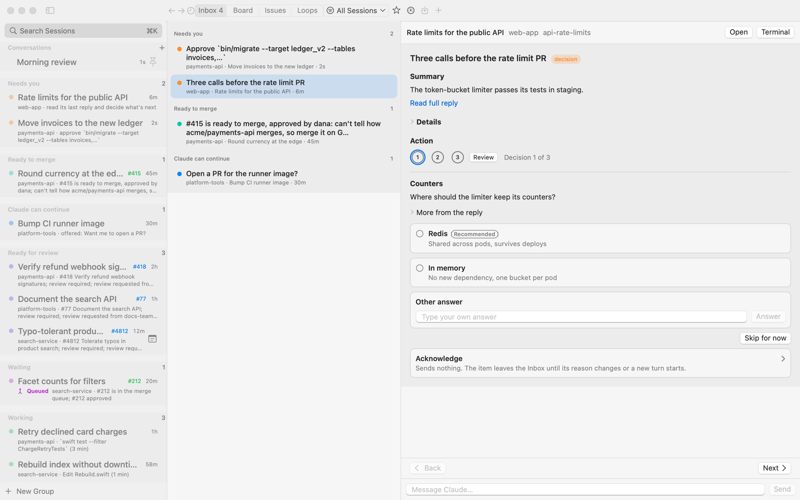
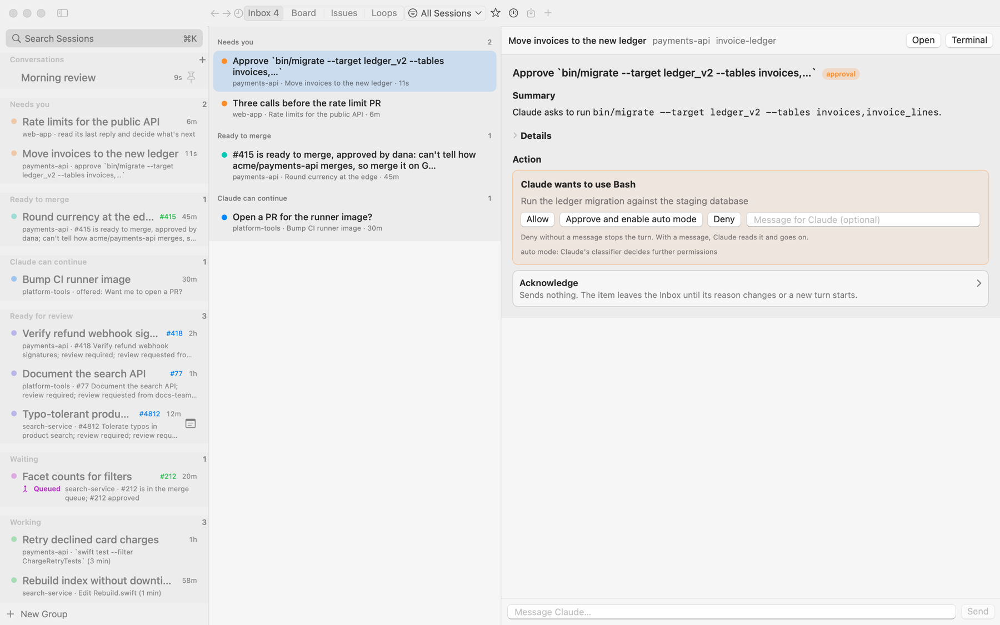
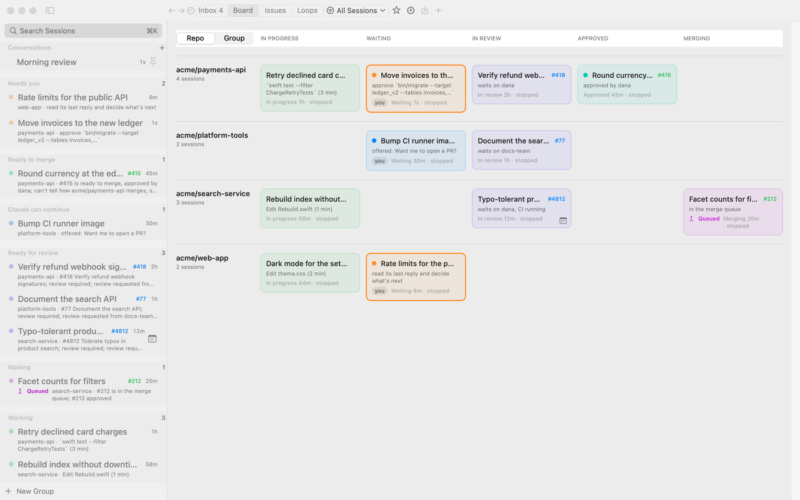
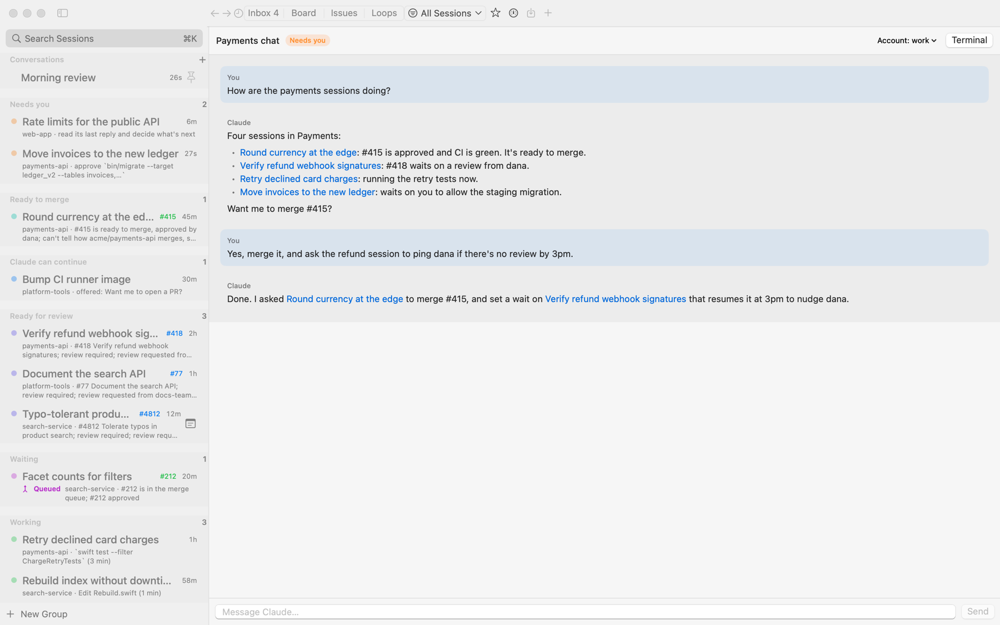
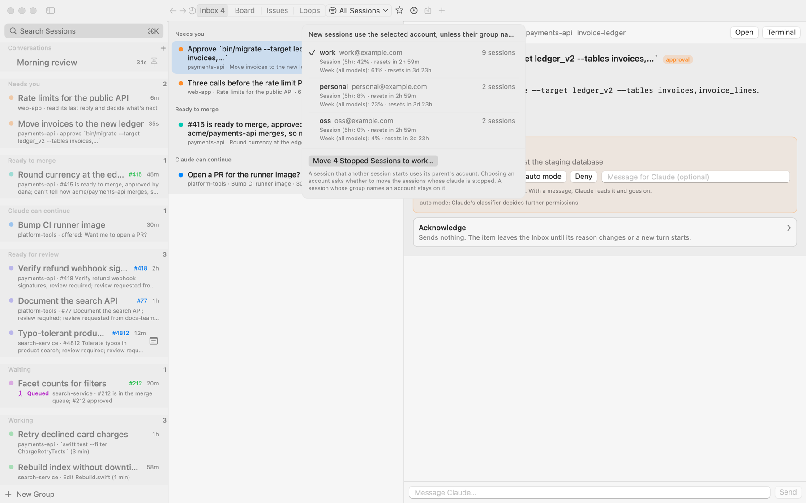
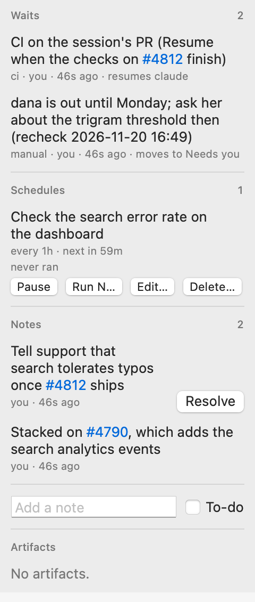
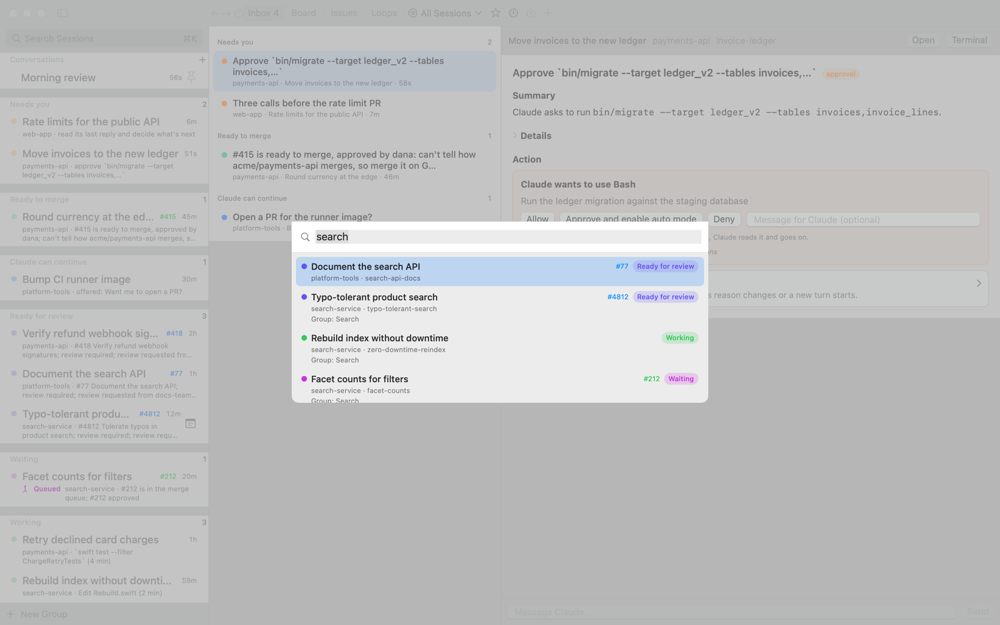

# Switchboard

A macOS app that runs 20 to 100 Claude Code sessions at once and shows which ones need you.

Each session is the real `claude` CLI in its own folder or git worktree, under your Claude subscription. Switchboard sorts the sessions by what they need from you, answers their prompts from one place, follows their pull requests, and stops the idle ones so a hundred sessions fit on one Mac.



## What it does

### The Inbox: answer sessions without opening a terminal

Every session that needs you gets one item in the Inbox. A permission prompt shows as a card with Allow and Deny. A question from Claude shows its options. When Claude's reply asks you to make several decisions, the Inbox lists them with the answer Claude recommends, and you send all your answers as one message. Before you answer one, you can ask the session about it in the decision's step, or with `sb decide <session> --ask <n> "<question>"`. Its reply shows under that decision while the session keeps its place in the Inbox, and the session gets your question with a request to answer in text only (see [Decision lists](docs/inbox.md#decision-lists)). ⌘J moves to the next item.



See [The Inbox](docs/inbox.md).

### The Board: every pull request from In progress to Merging

The Board puts each session's task in a column: In progress, Waiting, In review, Approved, or Merging. It has a lane per repo or per group. A card says what it waits on, such as a reviewer or CI, and offers the next step, such as Merge, Nudge, or a request to merge main in.



See [Sessions](docs/sessions.md#the-board).

### Group chats and the Manager

Put related sessions in a group, and the group gets a chat: a Claude session that starts, follows, and messages only that group's sessions. The Manager is a conversation that does the same across every session. Both work through `sb`, so they can start sessions, set waits, and report back.



See [Groups](docs/groups.md) and [The Manager](docs/manager.md).

### Usage across Claude accounts

The toolbar's gauge button names the active account and its 5-hour and weekly usage in its tooltip, and opens the account menu. The menu lists every signed-in account with its sessions and limits, and a click makes it the account for new sessions. A session keeps its account until you move it. Codex accounts (`~/.codex` and `~/.codex-*`) are listed too, with the limits from their newest Codex session. `sb account add <name> --agent codex` makes one and prints the command that signs it in. Sessions run only on Claude accounts for now.



See [Accounts](docs/accounts.md).

### Waits and notes

A wait says what a session is waiting on: CI, a review, a merge, a deploy, another session, or a time. Switchboard resolves most waits on its own and then resumes the session with what happened. Notes and to-dos stay with the session. The session view lists its waits, schedules, notes, artifacts, and links in a panel beside its terminals.



See [Waits, pauses, schedules, and notes](docs/waits-and-notes.md).

### Live cap and fast switching

`sbd` runs at most 10 `claude` processes at once by default. It stops idle sessions, queues new starts, and resumes a stopped session when you open it, click its terminal, or send it a message. A stopped session costs a few MB instead of 300 to 500. ⌘K searches every session by name, repo, branch, PR, issue, or notes, and ⌘[ and ⌘] go back and forward through the places you went. Press ? when no text field has focus, or choose Help > Keyboard Shortcuts (⌘/), to see the shortcuts for the view you are in.



See [Live cap and auto-continue](docs/live-cap.md).

## Quick start

On a Mac with macOS 14 or later, Xcode 26 or later, `tmux`, `gh` signed in, and Claude Code signed in:

```
curl -fsSL https://raw.githubusercontent.com/haacked/switchboard/main/bin/bootstrap | bash
```

This clones the repo to `~/dev/haacked/switchboard`, builds the app into `~/Applications`, links `sb` into `~/.local/bin`, starts the `sbd` service, and opens the app. From a checkout, `bin/install` and `bin/start` do the same, and `bin/update` updates to the latest `main`. See [Install](docs/install.md).

In the app, press ⌘N, pick a repository, turn on Create a worktree, and give the session its first prompt. Or start one from a terminal:

```
sb new ~/dev/myrepo --worktree --name "Fix the flaky test" --prompt "Fix the flaky test in foo_test.py"
```

The commands people use most:

```
sb ls                        # every session, with its state and why
sb triage                    # what needs you, in the order to go through it
sb send <session> "Yes, push it."
sb focus <session>           # shows the session in the app
sb wait <session> --kind ci  # resume the session when its PR's checks finish
sb note <session> --todo "Tell Alex the fix shipped"
sb rm <session> --worktree   # removes the session and its worktree
```

Everything in the app also works from `sb`, and every command takes `--json`. See [The sb command](docs/cli.md).

## Documentation

- [Install](docs/install.md)
- [Sessions](docs/sessions.md): the window, filters, the Board, messages, deleting, and cleanup
- [The Inbox](docs/inbox.md): triage, session summaries, and decision lists
- [Waits, pauses, schedules, and notes](docs/waits-and-notes.md)
- [The sb command](docs/cli.md)
- [Accounts](docs/accounts.md)
- [The Manager](docs/manager.md)
- [Groups](docs/groups.md): group chats and plan documents
- [Live cap and auto-continue](docs/live-cap.md)
- [Follow-ups, issues, and docket reviews](docs/follow-ups-and-issues.md)
- [sb on a remote host](docs/remote-hosts.md)
- [Settings](docs/settings.md)
- [How it works](docs/how-it-works.md)
- [Develop](docs/develop.md)

**Status:** v0.1, a first version to try. See [Develop](docs/develop.md) for what it covers and where the design plan lives.
